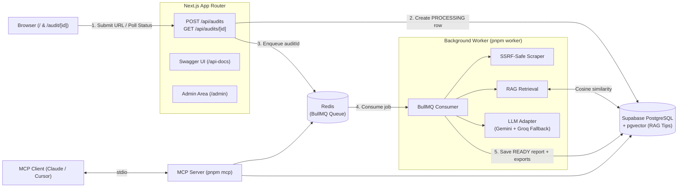

# SiteGap AI

[](https://github.com/Luxion07/sitegap-ai/actions/workflows/ci.yml)


SiteGap AI is a full-stack application for analyzing public website content and generating structured FAQ and content-gap audit reports.

Core engineering areas covered in this repository:

- Next.js App Router full-stack architecture & TypeScript
- PostgreSQL, Prisma, and `pgvector` semantic retrieval (RAG)
- Async background job processing with Redis & BullMQ (plus a standalone Go consumer spike in `experiments/go-worker`)
- Multi-provider AI report generation with structured output validation
- Model Context Protocol (MCP) server over `stdio`
- Internal admin tooling & rate limiting

This repository does not include production credentials, customer data, or commercial deployment configuration.

---

## What it does

A visitor pastes a public website URL and picks a business type. The app:

1. Validates the input, creates an `Audit` record with status `PROCESSING`, enqueues a background job in Redis (`BullMQ`), and immediately redirects to `/audit/[id]`.
2. In the background worker (`pnpm worker`), safely fetches the homepage (SSRF-protected: blocks private/loopback/link-local IPs, revalidates every redirect) and extracts readable text.
3. Retrieves relevant domain tips for that business category from PostgreSQL using `pgvector` cosine similarity (RAG).
4. Sends the extracted page text and retrieved tips to an LLM (Gemini primary with Groq fallback) to generate a structured report: a clarity score, questions the site already answers, questions it's missing, a ready-to-use FAQ, and a content improvement checklist.
5. Automatically updates `/audit/[id]` via status polling as soon as the report is `READY`, with Markdown and HTML FAQ exports.

An internal `/admin` area (password-protected, signed session cookie) lists all audits, lets an operator inspect a report's raw JSON, delete an audit, or manually mark one as failed.

Audit creation is rate-limited per IP (3/hour, 10/day) to keep LLM costs bounded.

> **Architecture Decision (Phase 9):** We initially prototyped a standalone Go worker (`BLPOP` + `pgxpool` + graceful shutdown) in [`experiments/go-worker`](experiments/go-worker/README.md). To keep the SSRF scraper, `pgvector` RAG retrieval, LLM prompt/schema pipeline, and export formatters as a single source of truth across Next.js, the MCP server, and the queue consumer, the production worker runs in TypeScript with BullMQ (`src/worker/index.ts`).

See `docs/SPEC.md` for the full functional spec and `docs/ARCHITECTURE.md` for the system design.

---

## System Architecture



---

## API Documentation (Swagger UI)

Interactive Swagger documentation is generated from inline `@swagger` JSDoc annotations in `src/app/api/**/route.ts`:

- **Swagger UI**: `http://localhost:3000/api-docs`
- **OpenAPI 3.0 JSON Spec**: `http://localhost:3000/api/swagger.json`
- **Bruno Collection**: `bruno/sitegap-api`

---

## Tech Stack

- Next.js App Router
- TypeScript
- pnpm
- Tailwind CSS
- shadcn/ui
- PostgreSQL (Supabase) + `pgvector`
- Prisma
- Redis + BullMQ (`ioredis`)
- LLM provider adapter (Gemini primary, optional Groq fallback)
- MCP SDK (`@modelcontextprotocol/sdk`)
- Vitest

---

## Project Docs

```text
/docs/SPEC.md
/docs/ARCHITECTURE.md
/TASKS.md
/AGENTS.md
/CLAUDE.md
```

Read these before implementation:

1. `docs/SPEC.md`
2. `docs/ARCHITECTURE.md`
3. `TASKS.md`

---

## Local Development

The database is hosted on Supabase — there is no local Postgres container.
Redis is required locally for the BullMQ audit queue (either via Homebrew `brew services start redis` or `docker compose up -d redis`).
Fill in `.env` before running migrations (see [Environment Variables](#environment-variables)).

```bash
cp env.example .env
docker compose up -d redis   # or use a local Redis instance on port 6379
pnpm install                 # also runs prisma generate
pnpm prisma:migrate
pnpm dev                     # terminal 1: Next.js web server
pnpm worker                  # terminal 2: BullMQ background audit worker
```

Prisma commands:

```bash
pnpm prisma:generate
pnpm prisma:migrate    # create + apply a migration locally
pnpm prisma:deploy     # apply existing migrations (CI/production)
pnpm prisma:studio
```

Other scripts:

```bash
pnpm worker            # start the BullMQ background audit worker
pnpm knowledge:ingest  # chunk & embed curated business tips into pgvector
pnpm mcp               # start the MCP server over stdio
pnpm test              # run the Vitest suite once
pnpm test:watch        # watch mode
pnpm lint              # ESLint
pnpm typecheck         # next typegen + tsc --noEmit
pnpm format            # Prettier, writes in place
pnpm build             # runs typecheck + lint first (prebuild), then next build
```

---

## MCP Server

SiteGap AI provides an MCP (Model Context Protocol) server over `stdio` that exposes core audit and tips retrieval features to AI clients (Claude Code, Claude Desktop, Cursor, etc.).

### Available Tools

- `search_tips` — Search curated business tips by query and business category (`LOCAL_SERVICE`, `B2B_SERVICE`, `AGENCY_CONSULTING`, `OTHER_SERVICE`).
- `create_audit` — Create and run a website content audit for a business URL with built-in SSRF protection and failure handling.
- `get_audit` — Check the status and retrieve the generated report JSON for an audit ID.

### Running & Testing

To start the MCP server directly over `stdio`:

```bash
pnpm mcp
```

To test and inspect tools interactively using the official MCP Inspector:

```bash
npx @modelcontextprotocol/inspector@latest pnpm mcp
```

### Connecting to Clients

#### Claude Code

The repository includes a `.mcp.json` configuration file:

```json
{
  "mcpServers": {
    "sitegap": {
      "command": "pnpm",
      "args": ["mcp"]
    }
  }
}
```

When running `claude` in this project directory, Claude Code discovers the server automatically.

#### Claude Desktop

Add the following to your `claude_desktop_config.json` (`~/Library/Application Support/Claude/claude_desktop_config.json` on macOS):

```json
{
  "mcpServers": {
    "sitegap": {
      "command": "pnpm",
      "args": ["mcp"],
      "cwd": "/path/to/sitegap-ai"
    }
  }
}
```

---

## Environment Variables

See `env.example` for the full list with comments. Grouped by what they're for:

- **Database** — `DATABASE_URL`, `DIRECT_URL` (Supabase connection strings).
- **App** — `NEXT_PUBLIC_APP_URL`, `NODE_ENV`.
- **LLM provider** (Phase 5) — `LLM_PROVIDER`, `LLM_API_KEY`, `LLM_MODEL`, and an optional `LLM_FALLBACK_*` trio.
- **Admin** (Phase 7) — `ADMIN_PASSWORD`, `ADMIN_SESSION_SECRET` (signs the session cookie).
- **Rate limiting** (Phase 8) — `RATE_LIMIT_SALT` (hashes client IPs before they're stored).
- **Background Queue** (Phase 9) — `REDIS_URL` (Redis connection string for BullMQ, defaults to `redis://localhost:6379` in development).

In production, `src/instrumentation.ts` checks that every required variable is set at server startup and fails fast if one is missing, instead of letting the server boot into a broken state.

Never commit `.env` or `.env.local`.

---

## Development Rules

- Implement one phase at a time (see `TASKS.md`).
- Keep route handlers thin.
- Put business logic in `src/modules/*`.
- Cover branching logic, validation, and security code with Vitest tests in the same phase that introduces it.
- Do not commit secrets.
- Do not add unplanned features without updating `TASKS.md`.
