# ARCHITECTURE.md

# Website FAQ & Gap Audit — Architecture

This document describes the MVP architecture using Mermaid diagrams. It is optimized for Obsidian and can be stored as:

```text
/docs/ARCHITECTURE.md
```

---

## 1. MVP System Context

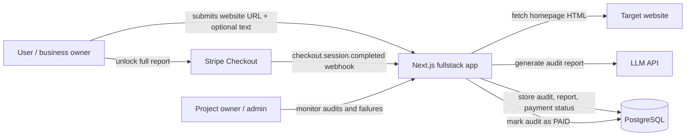

---

## 2. MVP Runtime Architecture

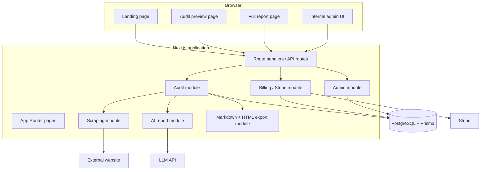

---

## 3. Audit Generation Sequence

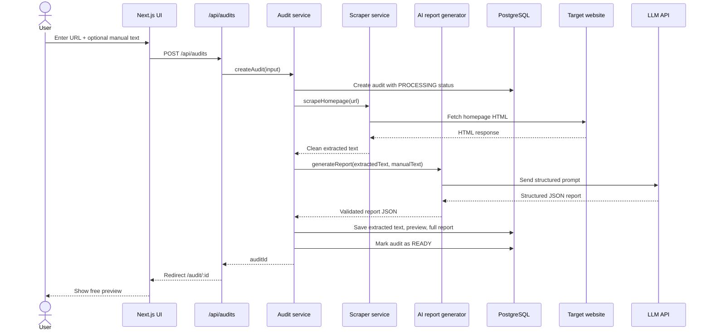

---

## 4. Payment Unlock Sequence

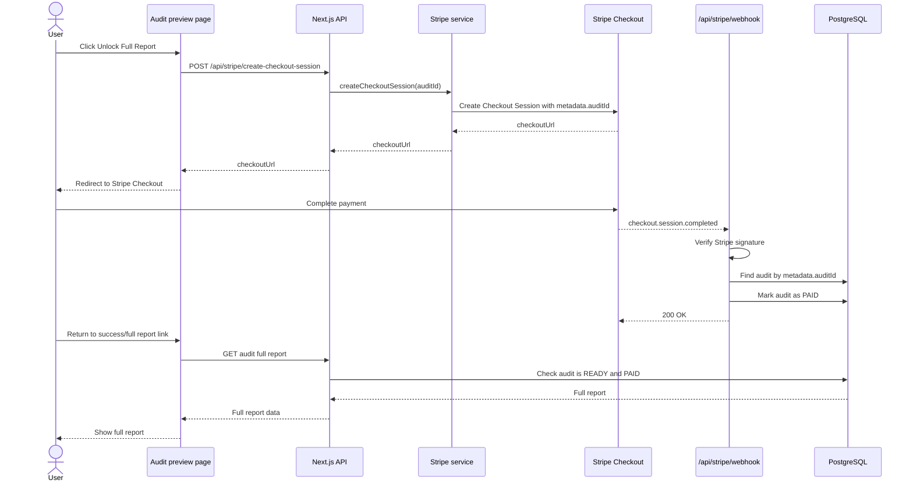

---

## 5. Admin Flow

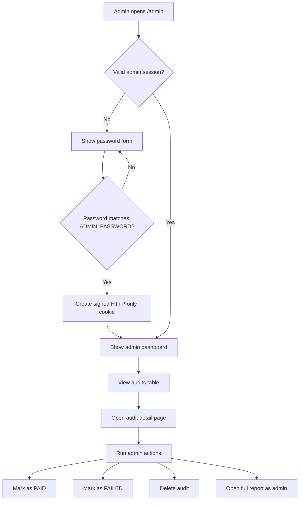

---

## 6. Audit Status Lifecycle

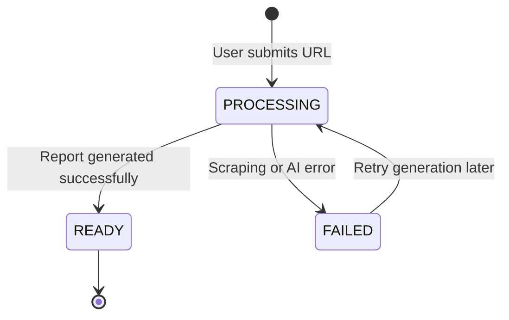

---

## 7. Payment Status Lifecycle

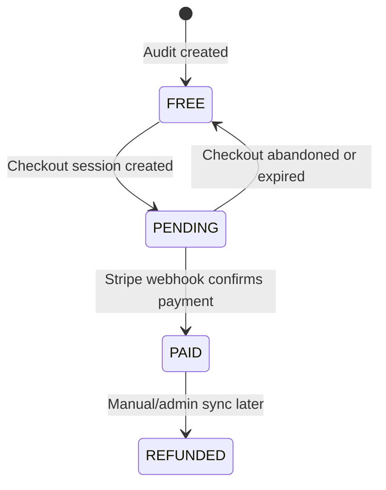

---

## 8. MVP Data Model

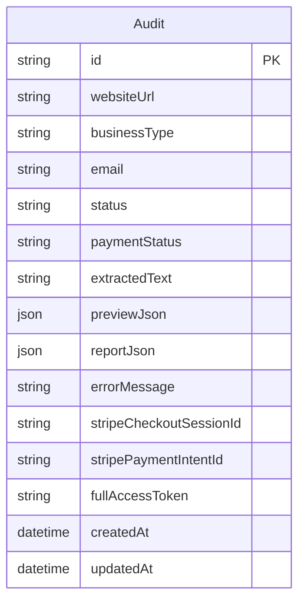

---

## 9. Recommended Module Structure

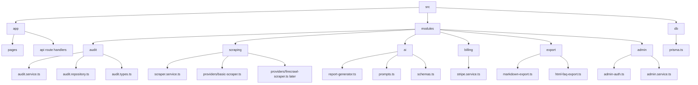

---

## 10. Future Architecture Evolution

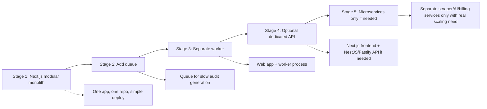

---

## 11. Future Worker Architecture

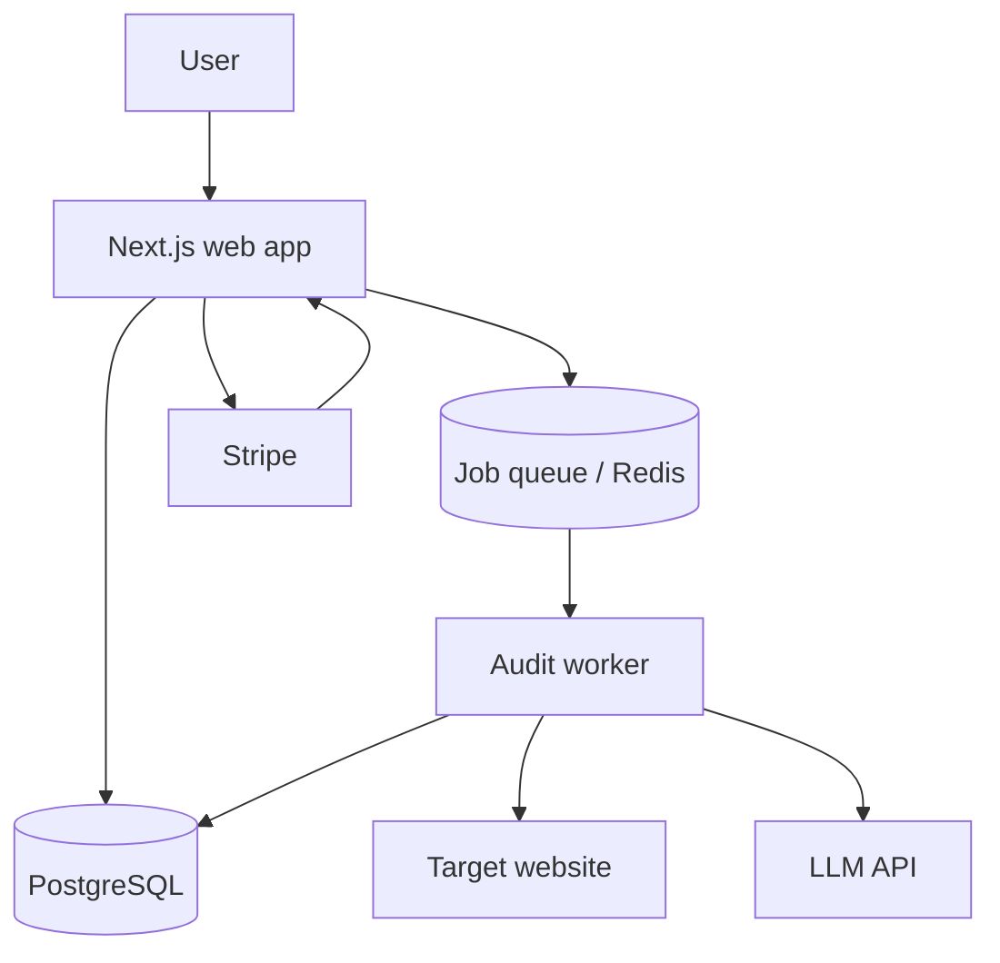

---

## 12. Implementation Order

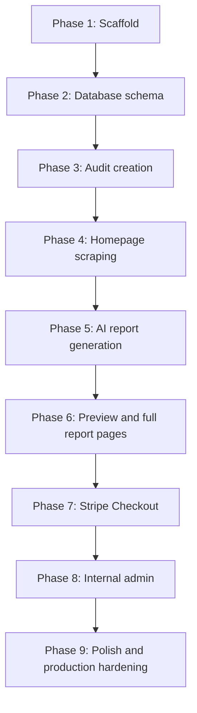

---

## 13. Phase 1 Scaffold Prompt for Claude/Codex

Use this prompt when starting implementation:

```text
Read /specs/SPEC.md and /docs/ARCHITECTURE.md.

Implement Phase 1 scaffold only.

Requirements:
- Create a Next.js application with TypeScript.
- Add Dockerfile and docker-compose.yml.
- Add PostgreSQL for local development.
- Add Prisma setup.
- Add .env.example.
- Add the recommended module folder structure.
- Add a basic landing page placeholder.
- Add a basic /admin placeholder page.
- Add a healthcheck route.
- Do not implement Stripe yet.
- Do not implement AI generation yet.
- Do not implement scraping yet.
- Do not implement payments yet.
- Keep route handlers thin.
- Put business logic inside modules.
- Ask before changing the architecture.
```

---

## 14. Notes

For the MVP, keep the system simple:

```text
Next.js fullstack app
PostgreSQL
Prisma
Stripe Checkout
Simple admin page
No chat
No RAG
No vector database
No subscriptions
No microservices
```

The architecture should be easy to grow, but the first implementation should stay small.
