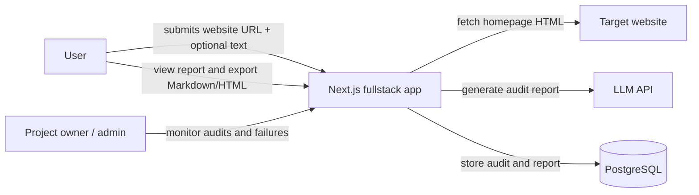
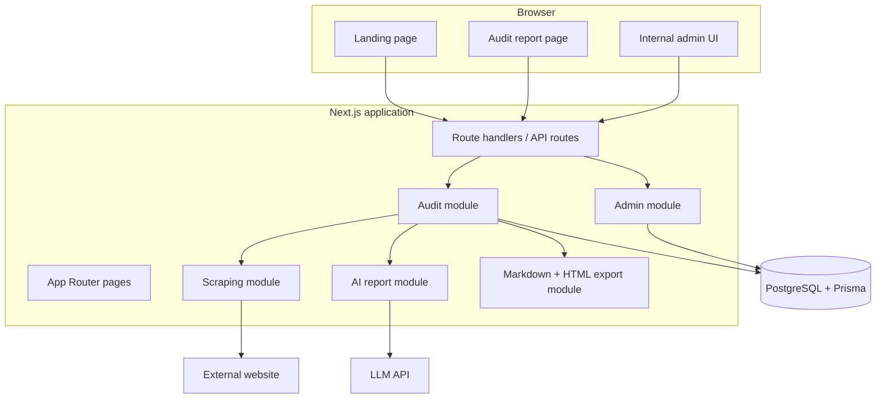
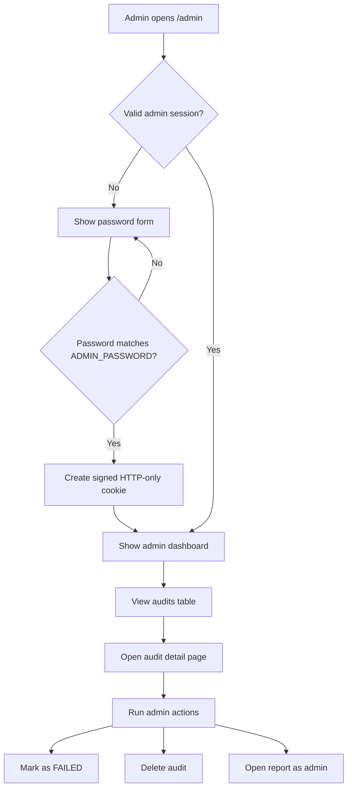
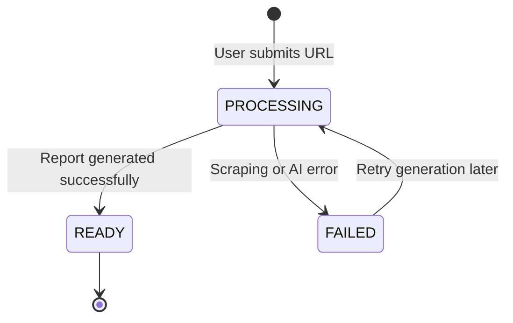
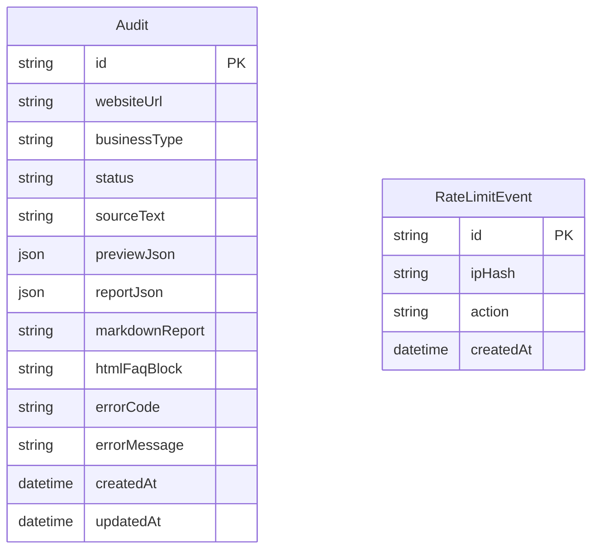
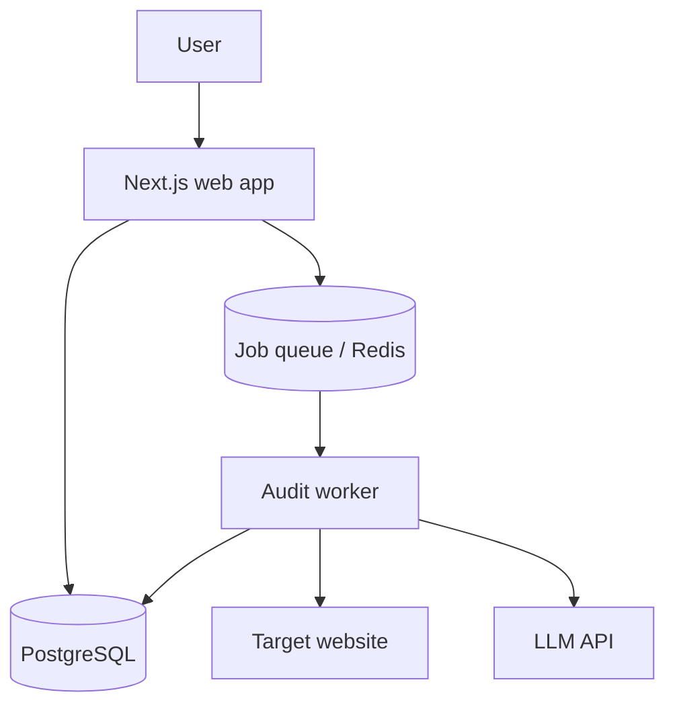
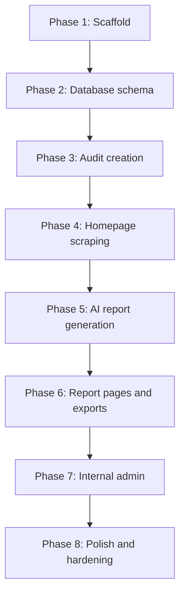
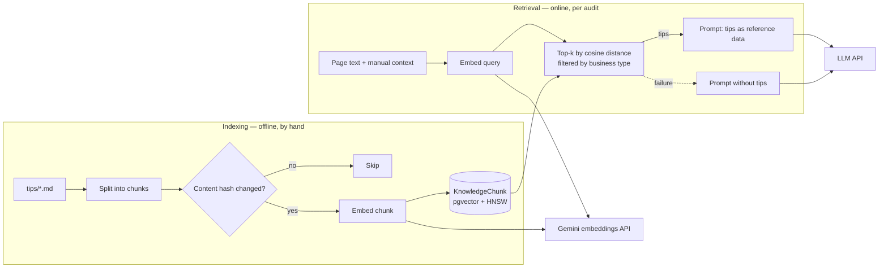
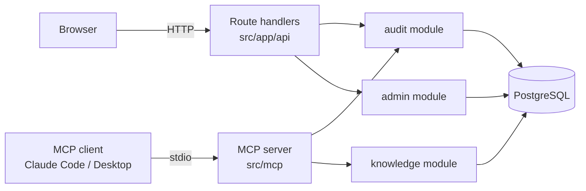

# ARCHITECTURE.md

# Website Content Audit Tool — Architecture

This document describes the technical prototype architecture using Mermaid diagrams. It is optimized for Obsidian and can be stored as:

```text
/docs/ARCHITECTURE.md
```

---

## 1. MVP System Context



---

## 2. MVP Runtime Architecture



---

## 3. Audit Generation Sequence


---

## 4. Admin Flow



---

## 5. Audit Status Lifecycle



---

## 6. MVP Data Model



---

## 7. Recommended Module Structure

```mermaid
flowchart TB
  Root[src]
  Root --> App[app]
  Root --> Modules[modules]
  Root --> DB[db]

  App --> Pages[pages]
  App --> API[api route handlers]

  Modules --> Audit[audit]
  Modules --> Scraping[scraping]
  Modules --> AI[ai]
  Modules --> Export[export]
  Modules --> Admin[admin]

  Audit --> AuditService[audit.service.ts]
  Audit --> AuditRepo[audit.repository.ts]
  Audit --> AuditTypes[audit.types.ts]

  Scraping --> ScraperService[scraper.service.ts]
  Scraping --> BasicScraper[providers/basic-scraper.ts]
  Scraping --> FirecrawlScraper[providers/firecrawl-scraper.ts later]

  AI --> ReportGenerator[report-generator.ts]
  AI --> Prompts[prompts.ts]
  AI --> Schemas[schemas.ts]

  Export --> Markdown[markdown-export.ts]
  Export --> HTML[html-faq-export.ts]
  Admin --> AdminAuth[admin-auth.ts]
  Admin --> AdminService[admin.service.ts]

  Modules --> Knowledge[knowledge — post-MVP, §13]
  Knowledge --> Tips[tips/*.md]
  Knowledge --> Ingest[ingest.ts]
  Knowledge --> Retrieval[retrieval.ts]
  Knowledge --> Embeddings[providers/gemini-embeddings.ts]

  Root --> MCP[mcp — post-MVP, §14]
  MCP --> McpServer[server.ts — stdio entry point]

  DB --> Prisma[prisma.ts]
```



---

## 8. Future Architecture Evolution


---

## 9. Future Worker Architecture



---

## 10. Implementation Order



---

## 11. Phase 1 Scaffold Prompt for Claude/Codex

Use this prompt when starting implementation:

```text
Read /docs/SPEC.md and /docs/ARCHITECTURE.md.

Implement Phase 1 scaffold only.

Requirements:
- Create a Next.js application with TypeScript.
- Use pnpm.
- Add Tailwind CSS and shadcn/ui.
- Add Dockerfile and docker-compose.yml.
- Add PostgreSQL for local development.
- Add Prisma setup.
- Add .env.example.
- Add the recommended module folder structure.
- Add a basic landing page placeholder.
- Add a basic /admin placeholder page.
- Add a healthcheck route.
- Do not implement AI generation yet.
- Do not implement scraping yet.
- Do not implement payments or billing.
- Keep route handlers thin.
- Put business logic inside modules.
- Ask before changing the architecture.
```

---

## 12. Notes

For the prototype, keep the system simple:

```text
Next.js fullstack app
PostgreSQL
Prisma
Simple admin page
No chat
RAG + pgvector only for the internal tips base (§13)
No payments
No subscriptions
No microservices
```

The architecture should be easy to grow, but the first implementation should stay small.

---

## 13. Post-MVP: Tips Knowledge Base (RAG)

Added in Phase 10 (see SPEC §30). RAG here is two separate pipelines:

- **Indexing (offline).** `pnpm knowledge:ingest`, run by hand after the tips
  change. Turns Markdown into vectors. Never runs during a user request.
- **Retrieval (online).** Runs inside report generation for every audit: one
  embeddings call plus one SQL query.

The expensive part (embedding every tip) happens once, not per audit, so the
request path only pays for embedding the query.



Module boundary: `knowledge` owns the tips, the embeddings adapter and the
retrieval query. `ai` only receives a list of tip strings and knows nothing
about vectors, so the prompt code doesn't depend on how tips are stored.

When Phase 9 lands, the Retrieval box moves into the Go worker together with
report generation. Indexing stays a TypeScript script.

---

## 14. Post-MVP: MCP Server

Added in Phase 11 (see SPEC §31). The MCP server is a second entry point in
front of the same modules, next to the route handlers. The modules don't know
whether a call came from a browser or from an AI agent (ports & adapters).



- **stdio:** the client starts `pnpm mcp` as a child process and talks over
  stdin/stdout. No port is opened, so nothing is exposed to the network.
- **No path to the admin module:** destructive actions stay behind the admin
  password (least privilege).
